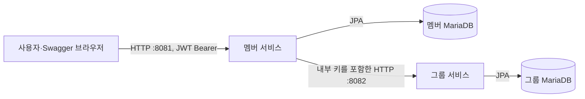

# task_20261104

멤버 기본 정보와 그룹 소속 정보를 조합해 조회하는 Kotlin·Spring Boot 기반 프로젝트다. Gradle 멀티 모듈 안에 독립 실행 가능한 멤버 서비스와 그룹 서비스를 구성한다.

**기동 후 Swagger 주소: [http://127.0.0.1:8081/swagger-ui.html](http://127.0.0.1:8081/swagger-ui.html)**

[실행과 종료](#실행과-종료) · [Swagger와 API 확인](#swagger와-api-확인) · [빌드와 테스트](#빌드와-테스트) · [AI 도구와 세션 기록](#ai-도구와-세션-기록)

## 프로젝트 목표

- 멤버 요약 목록과 상세를 제공하고, 필요한 그룹 정보는 그룹 서비스의 HTTP API로 조회해 조합한다.
- 메시지 브로커 없이 두 서비스가 독립적으로 기동·관리되도록 한다. 각 서비스가 자기 코드·DB·스키마·계정·볼륨을 소유하며 다른 서비스 코드나 DB를 직접 참조하지 않는다.
- CQRS의 조회 경로를 Controller → Query/입력 포트 → 조회 처리 → 저장소·외부 서비스 출력 포트로 분리한다. 현재 구현 범위는 조회 API다.
- 정의된 필드만 응답하고, OpenAPI 명세를 프런트엔드와 다른 서비스가 사용할 수 있는 계약으로 관리한다.
- AI 활용 과정의 프롬프트·응답·명령·파일 수정 기록을 저장소에 제출할 수 있도록 보존한다.

## 서비스와 프로젝트 구성



| 서비스 | 역할 | 앱 접근 | 개발 DB 접근 |
| --- | --- | --- | --- |
| [멤버](services/member-service/docs/README.md) | 사용자 진입점, 멤버 조회와 그룹 데이터 조합 | 127.0.0.1:8081 | 127.0.0.1:13306 |
| [그룹](services/group-service/docs/README.md) | 그룹·소속 관계 조회 | 내부 8082, 호스트 미공개 | 127.0.0.1:23306 |

사용자 → 멤버는 RS256 JWT Bearer로 인증한다(scope `member.read`). 멤버 → 그룹 호출은 호출자 ID와 내부 키를 사용하며 사용자 토큰을 전달하지 않는다. 그룹 API는 local 프로필에서만 멤버의 고정 중계(scope `group.read`)로 실행할 수 있다. 내부 키는 브라우저에 전달하지 않는다. 모든 API는 GET만 받고 다른 메서드는 405다. [보안 정책](docs/common/security.md)

루트 Compose는 두 서비스 구성을 모아 실행하고 앱 간 내부 네트워크를 연결한다. 서비스별 `infra/compose.yaml`이 자기 앱·DB·네트워크·볼륨을 관리한다. 공통 빌드 규칙은 공유하지만 서비스끼리 Gradle `project(...)` 의존을 만들지 않는다.

```text
task_20261104/
├─ services/
│  ├─ member-service/       멤버 앱: src/, docs/, infra/, Dockerfile
│  └─ group-service/        그룹 앱: src/, docs/, infra/, Dockerfile
├─ build-logic/             공통 Gradle 빌드·포맷 규칙, 로컬 키 생성
├─ gradle/                  버전 카탈로그와 Gradle Wrapper
├─ docs/
│  ├─ common/               공통 정책·설계 결정·실행 안내
│  ├─ tasks/                작업별 요청·계획·승인 내용
│  └─ verification/         실행·테스트 검증 기록
├─ scripts/                 AI 로그 수집기와 실행·문서 검증 도구
├─ tests/                   Python 도구 회귀 테스트
├─ ai-logs/snapshots/       제출용 AI 세션 기록
├─ compose.yaml            서비스별 Compose 통합
└─ compose.override.yaml   앱 간 내부 통신 설정
```

## 프로젝트 스펙

| 영역 | 구성 |
| --- | --- |
| 언어·실행 | JDK 21, Kotlin 2.3.21 |
| 프레임워크 | Spring Boot 4.1.2, Spring MVC, RestClient |
| 빌드 | Gradle Wrapper 9.3.0, 서비스별 독립 모듈 |
| 저장소 | Spring Data JPA·Hibernate, MariaDB 11.8.9, Flyway 마이그레이션 |
| 설계 | CQRS 조회 구조, 입력·출력 포트와 기술 어댑터 분리 |
| 인증 | Spring Security 7.1.2 OAuth2 Resource Server(JWT RS256), 그룹 내부 키 헤더 |
| API 명세 | springdoc-openapi 3.2.0, OpenAPI 3.1, Swagger UI |
| 포맷 | Spotless 8.9.0 + ktfmt 0.64 Google 스타일 |
| 검증 | JUnit, Testcontainers·MariaDB, ArchUnit, OpenAPI 응답 계약 검사 |

라이브러리는 Spring Boot BOM 관리 버전을 우선 사용한다. 버전 고정 위치와 상세 조합은 [기술 스택](docs/common/technology-stack.md), 코드 작성 규칙은 [코드 컨벤션](docs/common/code-conventions.md)을 따른다.

## 최소 설치 프로그램과 실행 조건

명령은 Windows PowerShell 기준이다. **Docker로 앱을 실행해도 최초 비밀 파일 생성에는 호스트 JDK 21이 필요하다.**

| 프로그램 | 필요한 작업과 조건 | 버전 기준·확인 |
| --- | --- | --- |
| JDK 21 | 비밀 파일 생성·빌드·테스트. `JAVA_HOME`과 `PATH`를 JDK 21로 설정 | `java -version`, `javac -version` |
| Docker Desktop 또는 Docker Engine | 실행 중인 Linux 컨테이너 환경, BuildKit·Docker API 접근 | 검증 기준 CLI/Engine 29.8.2. `docker version` |
| Docker Compose | `docker compose` 명령과 `include` 지원 | 기능 하한 2.20.3, 검증 버전 5.5.1. `docker compose version` |
| Git | 저장소 취득·브랜치·커밋·로그 제출 | 검증 버전 2.55.0.windows.5. `git --version` |
| Python 3.11 이상 | AI 로그 수집·Git hook·Python 검증 도구. 앱 실행 자체에는 불필요 | 검증 버전 3.12.10. `python --version` |
| 웹 브라우저 | Swagger에서 기능 확인 | 별도 Swagger 설치 불필요 |

Compose 2.20.3은 `include` 기능 하한이며 전체 프로젝트의 검증 버전은 5.5.1이다. 실제 호스트·Desktop·라이브러리 버전은 [기술 스택](docs/common/technology-stack.md)에 기록했다. [Docker include 조건](https://docs.docker.com/compose/how-tos/multiple-compose-files/include/)

Windows Docker Desktop은 Linux 컨테이너 모드로 실행한다. WSL 2를 사용하면 OS·가상화 조건도 준비한다([설치 조건](https://docs.docker.com/desktop/setup/install/windows-install/)). macOS·Linux 호스트의 전체 실행은 별도 검증 대상이다.

IDE는 선택 사항이며 사용할 때 프로젝트 SDK·Gradle JVM을 21로 설정한다. Swagger **자동** 검증에만 Node.js 24와 Microsoft Edge가 추가로 필요하다. 브라우저에서 수동으로 확인할 때는 Node.js가 필요하지 않다.

Gradle은 저장소의 **Wrapper 9.3.0**을 사용하므로 전역 Gradle을 설치하지 않는다. Kotlin·Spring Boot·JPA·Swagger 라이브러리는 Gradle이 받고, 호스트에 MariaDB 서버를 별도로 설치할 필요는 없다. 최초 실행에는 Gradle 배포·Maven 의존성·컨테이너 이미지를 내려받을 네트워크 접근이 필요하다.

기본 호스트 포트 `8081`, `13306`, `23306`이 사용 가능한지 확인한다. 그룹 앱 `8082`는 기본 일괄 실행에서 호스트에 공개하지 않는다. IDE·서비스 단독 실행의 차이는 [로컬 실행 문서](docs/common/local-development.md)를 따른다.

## 실행과 종료

Docker Desktop 또는 Docker Engine을 먼저 실행한 뒤, 저장소 루트에서 아래 순서대로 진행한다. 각 명령이 성공한 것을 확인한 후 다음 명령을 실행한다. Dockerfile이 소스를 빌드하므로 사전 bootJar 생성은 필요하지 않다.

### 시작

비밀 파일 준비 → 이미지 빌드·컨테이너 기동 → 상태 확인 순서다.

```powershell
# 1. 최초 실행에 필요한 비밀 파일 생성: DB 비밀번호·내부 키·JWT 키 쌍 (기존 파일은 유지)
./gradlew.bat generateLocalSecrets

# 2. 서비스 이미지 빌드 후 두 서비스·DB 기동 및 준비 상태 대기
docker compose up -d --build --wait

# 3. 기동 완료 후 컨테이너 상태 확인
docker compose ps
```

`member-service`, `group-service`, `member-db`, `group-db` 네 컨테이너가 모두 실행 중이고 `healthy`인지 확인한 뒤 API를 사용한다.

간편 실행 명령인 `./gradlew.bat startLocal`은 위 1·2단계를 순서대로 수행한다. 이를 사용해도 완료 후 `docker compose ps`로 상태를 확인한다. 비밀 파일이 이미 준비된 환경에서 재기동하거나 소스 변경을 반영할 때는 2·3단계를 실행한다.

### Swagger와 API 확인

브라우저에서 **[http://127.0.0.1:8081/swagger-ui.html](http://127.0.0.1:8081/swagger-ui.html)** 을 연다. 멤버와 그룹 API를 같은 화면에서 선택해 실행한다. local 프로필은 init 때 만든 키로 30분짜리 접근 토큰을 서명해 Swagger에 자동으로 넣는다(**Authorize** 입력 불필요). 화면 위쪽에 만료 시각이 보이며, 만료되면 페이지를 새로 고친다.

| 확인 대상 | 주소 | 정상 기준 |
| --- | --- | --- |
| Swagger UI | [http://127.0.0.1:8081/swagger-ui.html](http://127.0.0.1:8081/swagger-ui.html) | 서비스 선택과 API 목록 표시 |
| 멤버 준비 상태 | [http://127.0.0.1:8081/actuator/health/readiness](http://127.0.0.1:8081/actuator/health/readiness) | HTTP 200, `status: UP` |
| 멤버 OpenAPI JSON | [http://127.0.0.1:8081/v3/api-docs](http://127.0.0.1:8081/v3/api-docs) | 멤버 조회 API 두 개, `bearerAuth`, 상태별 오류 응답 |
| 멤버 경유 그룹 OpenAPI JSON | [http://127.0.0.1:8081/internal-docs/group](http://127.0.0.1:8081/internal-docs/group) | 그룹 조회 API 두 개 |

1. 서비스 선택에서 **멤버 서비스**를 고른다.
2. 확인할 API를 펼치고 **Try it out**을 누른다. 아래 입력값을 넣고 **Execute**로 실행한다.
3. **Response code**와 **Response body**를 확인한다.
4. **그룹 서비스 (멤버 경유)**로 바꾼 뒤 같은 방식으로 그룹 API를 실행한다.

아래 값은 루트 Compose의 `local` 시드 기준이다. 기존 DB 데이터를 변경했다면 실제 저장된 멤버 ID를 사용한다.

| 선택한 서비스·API | 입력 예시 | 기대 결과 |
| --- | --- | --- |
| 멤버 `GET /api/members` | `page=0`, `size=20`, `sort=name,asc` | 200. `members`와 `page`, 각 항목에 id/name/group/permission |
| 멤버 `GET /api/member/{memberId}` | `memberId=tu3fgxd45k` | 200. 멤버 기본 정보와 단일 `group` |
| 그룹 `GET /api/groups/summary` | `memberIds` 배열에 `tu3fgxd45k` 한 개 입력 | 200. `group` 배열, 요청 멤버 소속과 그룹 전체 인원 |
| 그룹 `GET /api/group/{memberId}` | `memberId=tu3fgxd45k` | 200. memberId/groupId/groupName/registeredDate/pricing/permission |

미소속 확인에는 `k2m9x0p1q3`을 사용한다. 멤버 상세는 200과 `group: null`, 그룹 상세는 404 `RESOURCE_NOT_FOUND`(type `urn:problem-type:group-membership-not-found`)가 정상이다. 멤버 목록의 `page=-1`은 400 `INVALID_PARAMETER`, `size=0`은 422 `VALIDATION_FAILED`다. 그룹 summary에 같은 ID를 두 번 넣으면 200으로 한 번만 응답하고 그룹 서비스 로그에 중복 ID 경고가 남는다.

그룹 앱의 `8082` 포트는 호스트에 공개하지 않는다. 그룹 Swagger 실행 요청은 `http://127.0.0.1:8081/internal-api/group` 아래로 전달되며, 멤버 서버가 내부 호출 키를 추가한다. 브라우저에서 키를 입력하거나 그룹 서버를 직접 호출할 필요가 없다.

터미널에서는 다음처럼 확인할 수 있다. PowerShell에서는 `curl.exe`를 사용한다. local 토큰은 Swagger 초기화 스크립트에서 받는다(30분 만료, local 프로필 전용).

```powershell
curl.exe --noproxy "*" -i "http://127.0.0.1:8081/actuator/health/readiness"
$init = curl.exe --noproxy "*" -s "http://127.0.0.1:8081/swagger-ui/swagger-initializer.js"
$token = [regex]::Match(($init -join "`n"), '"accessToken":"([^"]+)"').Groups[1].Value
curl.exe --noproxy "*" -i -H "Authorization: Bearer $token" "http://127.0.0.1:8081/api/members?page=0&size=20&sort=name,asc"
curl.exe --noproxy "*" -i -H "Authorization: Bearer $token" "http://127.0.0.1:8081/api/member/tu3fgxd45k"
curl.exe --noproxy "*" -i -H "Authorization: Bearer $token" "http://127.0.0.1:8081/internal-api/group/api/group/tu3fgxd45k"
# 토큰 없이 호출하면 401 UNAUTHORIZED, GET 외 메서드는 405 METHOD_NOT_ALLOWED
curl.exe --noproxy "*" -i "http://127.0.0.1:8081/api/members"
curl.exe --noproxy "*" -i -X POST "http://127.0.0.1:8081/api/members"
```

오류 응답은 RFC 9457 ProblemDetail에 `code`를 더한 형식이다. 상태별 `code`(400 `INVALID_PARAMETER`, 401 `UNAUTHORIZED`, 403 `FORBIDDEN`, 404 `RESOURCE_NOT_FOUND`, 405 `METHOD_NOT_ALLOWED`, 422 `VALIDATION_FAILED`, 429 `TOO_MANY_REQUESTS`, 500·502·503·504 등)와 세부 원인 `type`은 [API 규칙](docs/common/api-conventions.md#pol-api-002)에 있다.

기동에 실패하거나 API 응답이 예상과 다르면 `docker compose ps -a`와 `docker compose logs --tail=100 member-service group-service member-db group-db`로 상태·로그를 확인한다. 상세한 실행 환경별 점검은 [로컬 실행](docs/common/local-development.md#실행-문제-확인)을 따른다.

### 종료

기능 확인을 마친 뒤 컨테이너 종료·제거 → 종료 상태 확인 순서로 진행한다.

```powershell
# 두 서비스와 DB 컨테이너 종료·제거 (데이터 볼륨 유지)
docker compose down

# 해당 Compose 프로젝트에 남은 컨테이너가 없는지 확인
docker compose ps -a
```

종료 후 `docker compose ps -a`에 해당 프로젝트의 컨테이너 행이 없으면 종료·제거가 완료된 것이다. 데이터 볼륨을 삭제하는 `-v`는 사용하지 않는다.

clone에는 `secrets/`가 포함되지 않으므로 최초 실행 때 1단계로 생성한다. 기존 DB 볼륨을 재사용하는데 DB 비밀번호 파일을 잃었다면 새 임의 비밀번호로 복구되지 않는다. 기존 파일을 복원하거나 별도 개발 환경을 준비한다.

서비스별 독립 실행·IDE·DB 전용 실행·기존 DB 갱신은 [로컬 실행](docs/common/local-development.md)을 따른다. 루트 일괄 실행과 단독 실행의 데이터 볼륨은 다르다.

## API 요약

| API | 역할 | 계약 |
| --- | --- | --- |
| GET /api/members | 이름 정렬·페이지 기반 멤버 요약, 그룹 조합 | [멤버 API](services/member-service/docs/api.md) |
| GET /api/member/{memberId} | 멤버 기본 정보와 소속 상세 | [멤버 API](services/member-service/docs/api.md) |
| GET /api/groups/summary | 요청 멤버들의 소속과 그룹 전체 인원 | [그룹 API](services/group-service/docs/api.md) |
| GET /api/group/{memberId} | 해당 멤버의 단일 그룹 상세 6필드 | [그룹 API](services/group-service/docs/api.md) |

멤버 API는 JWT(scope `member.read`)가 필요하다. 그룹 경로는 내부 계약이다. local Swagger에서는 멤버의 `/internal-api/group` 아래 두 고정 GET 경로로 실행한다. 저장은 UTC TIMESTAMP(6), 업무 응답 시각은 한국 시간 `yyyy-MM-dd HH:mm`이다. 현재 소속은 멤버당 0~1개이며 응답의 정확한 필드는 서비스 API 정의서가 소유한다.

공유 계약 파일은 [멤버 OpenAPI](services/member-service/docs/openapi.json)와 [그룹 OpenAPI](services/group-service/docs/openapi.json)이다. 소비자는 서비스 구현 대신 이 명세를 사용한다. 현재 멤버 계약은 0.4.0, 그룹 계약은 0.2.0이며 변경·검증 근거는 [REVIEW-002 검증](docs/verification/REVIEW-002/verification.md)에 있다.

## 빌드와 테스트

통합 테스트용 Docker가 실행 중이어야 한다. 명령은 저장소 루트 기준이다.

```powershell
./gradlew.bat build --no-daemon --console=plain
./gradlew.bat :member-service:build --no-daemon --console=plain
./gradlew.bat :group-service:build --no-daemon --console=plain
python -X utf8 -I scripts/verification/docs-check.py
```

전체 build에는 포맷 검사·테스트·공유 OpenAPI 대조가 포함된다. 일반 build로 저장소의 OpenAPI를 갱신하지 않는다. 실행 검증·공급자별 검증 범위와 정책은 [테스트](docs/common/testing.md), 결과는 [검증 색인](docs/verification/README.md)을 따른다.

루트 Compose를 기동한 상태에서 실제 HTTP·Swagger 동작을 자동 확인할 수도 있다.

```powershell
python -X utf8 -I scripts/verification/runtime-smoke.py
node scripts/verification/swagger-browser.mjs
```

첫 명령은 API·입력·네트워크·명세·요청 추적을, 두 번째는 실제 Edge에서 네 API의 Try it out을 검사한다. 서비스 중단·단독 기동까지 확인하는 `--independence` 옵션은 실행 중인 앱·DB를 일시 전환하므로 [테스트 절차](docs/common/testing.md#실행브라우저-검증)를 확인한 뒤 사용한다.

## 문서

- [문서 시작점](docs/README.md): 현재 공통 정책·서비스 정의·작업·검증을 구분한다.
- [공통 규칙](docs/common/README.md): 아키텍처, CQRS, 코드 컨벤션, API, 보안, 데이터, 통신, 실행.
- [작업 색인](docs/tasks/README.md): 요청·계획·결정·후속 인계.
- [커밋·브랜치](docs/common/commit-conventions.md): master에서 feature 생성 → develop 검증 → 검증된 feature만 master 반영. master 병합·push는 사용자 절차다.

## AI 도구와 세션 기록

| 도구 | 활용 | 수집 설정 |
| --- | --- | --- |
| Codex (VS Code 확장·CLI) | 요구·계획 검토, 코드 수정, 빌드·테스트·실제 실행 검증 | `.codex/hooks.json` |
| Claude Code | 작업 요청·계획·문서 정리, 코드 작업과 검토 | `.claude/settings.json` |

요구사항과 결정은 `docs/tasks/`, 실행 결과는 `docs/verification/`에 남기고 두 도구의 검토 내용을 대조했다. AI가 제안한 내용과 실제 테스트로 확인한 결과를 구분한다.

두 도구가 자동 저장한 **로컬 원본 트랜스크립트**를 hook과 Python 수집기(`scripts/ai_logging/`)로 모으는 구조다. 프롬프트·AI 응답·도구 호출·명령 결과·파일 수정 내역을 수집한다. 원본은 보존하고 제출용 사본의 비밀값·개인정보만 `****`로 마스킹하며, 그 외 내용이나 줄 순서를 편집하지 않는다.

- 제출 위치: `ai-logs/snapshots/`. 검증된 세션 전체 사본을 누적 보존한다. 개발용 `ai-logs/live/`와 `.ai-logging/`의 등록·보류·치환 목록은 Git 제외다.
- 함께 제공하는 설정·스크립트: 위 hook 파일, `.githooks/`, `config/ai-logging.json`, `scripts/ai_logging/`.
- 상태 확인: `python -X utf8 -I scripts/ai_logging/cli.py status`.
- 설치·동기화·제출 절차는 [AI 로깅 운영](docs/common/ai-logging.md), 확인한 실행 범위와 남은 제한은 [최신 검증 기록](docs/verification/REVIEW-002/verification.md#ai-로그와-병합-상태)을 따른다.

hook 실행 미확인·보류·스냅샷 꼬리 지연은 정상 수집 완료로 간주하지 않는다. 최종 제출은 모든 AI 응답 종료 후 완전성 검사 결과로 판단한다. 원본·스냅샷을 직접 수정하거나 스테이징하지 않는다.
