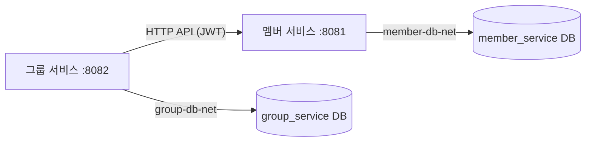

# 아키텍처

| 항목 | 내용 |
| --- | --- |
| 목적 | 서비스 경계와 서비스 사이의 의존 규칙을 정한다 |
| 범위 | 멤버 서비스, 그룹 서비스, 공통 빌드 규칙, 서비스별 인프라 |
| 관련 코드 | `settings.gradle.kts`, `build-logic/src/main/kotlin/task.spring-service.gradle.kts`, `services/*/infra/compose.yaml` |

## 구성

| 관리 대상 | 멤버 서비스 | 그룹 서비스 | 공통 |
| --- | --- | --- | --- |
| 책임 | 멤버 정보 조회 | 그룹·소속 관계 조회 | 공통 규칙 |
| 데이터 | 멤버 정보 | 그룹 정보, 멤버 식별자, 소속 관계 | 데이터 규칙([data-conventions](data-conventions.md)) |
| DB | 전용 PostgreSQL·DB·스키마·계정 | 전용 PostgreSQL·DB·스키마·계정 | - |
| 인프라 | Compose 프로젝트 `task-member` | Compose 프로젝트 `task-group` | - |
| 빌드 | `:member-service` bootJar·이미지 | `:group-service` bootJar·이미지 | `build-logic` 빌드 규칙 |

## POL-ARCH-001 서비스 경계

- 서비스는 자기 데이터만 소유하고 자기 DB에만 접근한다.
- 다른 서비스의 DB·스키마·계정 정보를 갖지 않는다.
- 메시지 브로커를 쓰지 않는다.

## POL-ARCH-002 직접 참조 금지

- 서비스 사이에 `project(...)` 의존을 만들지 않는다.
  - `build-logic`이 서비스 프로젝트의 project 의존을 찾으면 구성 단계에서 빌드를 실패시킨다.
- 서비스 간에 공유하는 런타임 모듈(공통 DTO·엔티티·유틸)도 두지 않는다([ADR-002](decisions/ADR-002-no-shared-module.md)).
- 보안 설정·오류 처리기처럼 두 서비스에 같은 코드가 있어도 각 서비스가 따로 가진다. 규칙은 이 공통 문서들이 정한다.

## POL-ARCH-003 통신

- 서비스 간 통신은 HTTP API 호출만 한다([service-communication](service-communication.md)).
- 다른 서비스의 엔티티·코드·DB를 직접 참조하지 않는다. 필요한 데이터는 그 서비스 API로 받는다.
- 두 서비스의 데이터를 같은 시점의 단일 트랜잭션 결과로 보장하지 않는다.

## POL-ARCH-004 인프라 소유

- 서비스마다 자기 Compose 파일(`services/<서비스>/infra/compose.yaml`)과 프로젝트명을 가진다.
  - 멤버: `task-member`, 그룹: `task-group`.
- Compose 파일은 자기 앱·DB·네트워크·볼륨·비밀값만 정의한다.
  - 다른 서비스에 대한 `depends_on`이 없다.
  - 고정 `container_name`이나 전역 볼륨 이름을 쓰지 않는다. 리소스 이름은 프로젝트명으로 구분된다.
- DB 네트워크(`member-db-net`, `group-db-net`)에는 자기 앱과 자기 DB만 붙는다.
- 한 서비스를 시작·종료·재빌드해도 다른 서비스의 실행 환경은 바뀌지 않는다.

## POL-ARCH-005 독립 산출물

- 서비스마다 `build/libs/<서비스>.jar` 하나와 이미지 하나를 만든다.
  - 이미지에는 그 서비스의 jar만 들어간다.
  - Docker 빌드 컨텍스트는 서비스 폴더이고, `.dockerignore`로 jar만 남긴다.
- 서비스별로 빌드·테스트·이미지 생성을 따로 실행할 수 있다(`./gradlew :member-service:build`).
- 공통 빌드 규칙(`build-logic`, `gradle/libs.versions.toml`)을 바꾸면 두 서비스를 모두 빌드·테스트한다.
