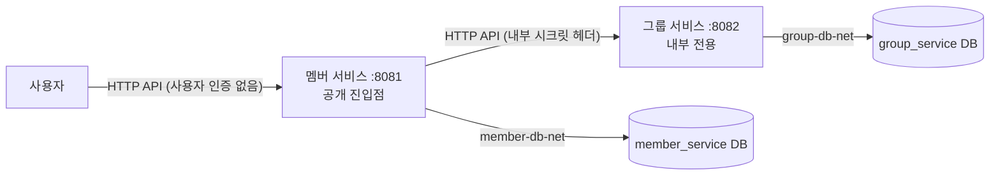

# 아키텍처

| 항목 | 내용 |
| --- | --- |
| 분류 | 공통 기준 |
| 상태 | 현재 · 적용 예정 사항은 해당 절에서 구분 |
| 목적 | 서비스 경계와 서비스 사이의 의존 규칙을 정한다 |
| 범위 | 멤버 서비스, 그룹 서비스, 공통 빌드 규칙, 서비스별 인프라 |
| 관련 코드 | `settings.gradle.kts`, `build-logic/src/main/kotlin/task.spring-service.gradle.kts`, `services/*/infra/compose.yaml` |

현재 구조는 [ADR-005](decisions/ADR-005-member-edge-group-internal.md)와 [구조 변경 계획](../tasks/SETUP-001/structure-change-plan.md)을 따른다. 검증 결과는 [재검증 기록](../verification/SETUP-001/setup-verification.md)에서 구분한다.

## 구성

| 관리 대상 | 멤버 서비스 | 그룹 서비스 | 공통 |
| --- | --- | --- | --- |
| 공개 범위 | 사용자에게 공개(유일한 진입점) | 내부 전용. 내부 키를 확인한 요청 처리 | 접근 통제([POL-SEC-006](security.md#pol-sec-006-그룹-서비스-접근-통제)) |
| 책임 | 멤버 정보 조회, 사용자용 공개 API(그룹 데이터가 필요한 조회 포함) | 그룹·소속 관계 조회(내부 API) | 공통 규칙 |
| 다른 서비스 호출 | 그룹 서비스 호출(소비자) | 없음 | [service-communication](service-communication.md) |
| API 문서 | Swagger에서 두 명세 선택·실행 | 멤버 서버를 경유하여 명세 제공 및 두 조회 실행 | [POL-API-004](api-conventions.md#pol-api-004-api-문서) |
| 데이터 | 멤버 정보 | 그룹 정보, 멤버 식별자, 소속 관계 | 데이터 규칙([data-conventions](data-conventions.md)) |
| DB | 전용 MariaDB·DB·스키마·계정 | 전용 MariaDB·DB·스키마·계정 | - |
| 인프라 | 단독 Compose `task-member` | 단독 Compose `task-group` | 일괄 실행 진입점 `task-local` |
| 빌드 | `:member-service` bootJar·이미지 | `:group-service` bootJar·이미지 | `build-logic` 빌드 규칙 |

## POL-ARCH-001 서비스 경계

- 서비스는 자기 데이터만 소유하고 자기 DB에만 접근한다.
- 다른 서비스의 DB·스키마·계정 정보를 갖지 않는다.
- 메시지 브로커를 쓰지 않는다.

## POL-ARCH-002 직접 참조 금지

- 서비스 사이에 `project(...)` 의존을 만들지 않는다.
  - `build-logic`이 서비스 프로젝트의 project 의존을 찾으면 구성 단계에서 빌드를 실패시킨다.
- 서비스 간에 공유하는 런타임 모듈(공통 DTO·엔티티·유틸)도 두지 않는다([ADR-002](decisions/ADR-002-no-shared-module.md)).
- 보안 설정·오류 처리기처럼 두 서비스에 같은 코드가 있어도 각 서비스가 따로 가진다. 규칙은 이 공통 문서들이 정한다.

## POL-ARCH-003 통신

- 서비스 간 통신은 HTTP API 호출만 한다([service-communication](service-communication.md)).
- 호출 방향은 멤버 → 그룹 단방향이다([POL-ARCH-006](#pol-arch-006-공개-범위와-호출-방향)).
- 다른 서비스의 엔티티·코드·DB를 직접 참조하지 않는다. 필요한 데이터는 그 서비스 API로 받는다.
- 두 서비스의 데이터를 같은 시점의 단일 트랜잭션 결과로 보장하지 않는다.

## POL-ARCH-004 인프라 소유

- 서비스마다 자기 Compose 파일(`services/<서비스>/infra/compose.yaml`)과 프로젝트명을 가진다.
  - 멤버: `task-member`, 그룹: `task-group`.
- Compose 파일은 자기 앱·DB·네트워크·볼륨·비밀값만 정의한다.
  - 다른 서비스에 대한 `depends_on`이 없다.
  - 고정 `container_name`이나 전역 볼륨 이름을 쓰지 않는다. 리소스 이름은 프로젝트명으로 구분된다.
- DB 네트워크(`member-db-net`, `group-db-net`)에는 자기 앱과 자기 DB만 붙는다.
- 그룹 앱은 호스트에 포트를 열지 않는다. DB 포트(127.0.0.1)는 IDE 개발용으로 둔다.
- 멤버·그룹 앱 사이의 내부 서비스 네트워크는 루트 통합 Compose가 소유한다. 서비스 Compose는 이 네트워크를 모르므로 단독 실행이 다른 서비스에 묶이지 않는다.
- 루트 `compose.yaml`은 서비스 파일을 `include`하는 로컬 개발 진입점이다. 서비스 정의를 중복하지 않고 각 서비스가 인프라의 소유권을 유지한다.
- 일괄 실행의 프로젝트명은 `task-local`이다. DB 네트워크와 데이터 볼륨은 서비스별로 분리되며 모드별 볼륨 관계는 [로컬 실행](local-development.md)을 따른다.
- 단독 Compose 또는 일괄 Compose의 서비스 대상 명령으로 한 서비스만 시작·중단·재빌드할 수 있다.

## POL-ARCH-005 독립 산출물

- 서비스마다 `build/libs/<서비스>.jar` 하나와 이미지 하나를 만든다.
  - 이미지에는 그 서비스의 jar만 들어간다.
  - Docker 빌드 컨텍스트는 저장소 루트다. 서비스 소유 `Dockerfile.dockerignore`가 공통 Gradle 파일·두 모듈의 빌드 선언·해당 서비스 운영 소스만 허용한다. 다른 서비스 운영 소스와 비밀값·AI 기록·로컬 산출물은 제외한다.
  - JDK 빌드 단계에서 해당 `bootJar`만 생성하고 JRE 실행 단계로 jar만 복사한다. 이미지마다 독립 실행된다.
- 서비스별로 빌드·테스트·이미지 생성을 따로 실행할 수 있다(`./gradlew :member-service:build`).
- 공통 빌드 규칙(`build-logic`, `gradle/libs.versions.toml`)을 바꾸면 두 서비스를 모두 빌드·테스트한다.

## POL-ARCH-006 공개 범위와 호출 방향

- 외부 진입점은 멤버 서비스 하나다. 사용자는 멤버 서비스만 호출한다.
- 그룹 서비스는 내부 전용이다. 외부에 호스트 포트를 열지 않으며 내부 키를 검사한다([POL-SEC-006](security.md#pol-sec-006-그룹-서비스-접근-통제)).
- 그룹의 두 조회는 멤버의 고정 중계 경로를 통해서도 실행할 수 있다. 현재 중계에는 사용자 인증이 없다. 그룹 직접 포트 미공개와 멤버 경유 API의 접근 가능성을 구분한다.
- 호출은 멤버 → 그룹 단방향이다. 그룹은 다른 서비스를 호출하지 않는다. 순환 호출을 만들지 않는다.
- 그룹 데이터가 필요한 사용자 기능은 멤버 API로 정의하고, 멤버가 그룹을 호출해 응답을 만든다.
- 그룹 장애는 멤버의 기동·readiness를 막지 않는다. 그룹 데이터가 필요한 멤버 API만 실패한다([POL-COMM-004](service-communication.md#pol-comm-004-인증과-실패-처리)).
- 구현 항목과 범위는 [구조 변경 계획](../tasks/SETUP-001/structure-change-plan.md), 실제 결과는 [재검증 기록](../verification/SETUP-001/setup-verification.md)을 따른다.

- 통합 통신 네트워크는 `compose.override.yaml`이 소유한다. 내부 대역 `172.30.104.0/24`, 멤버 `.2`, 그룹 `.3`을 사용한다. IP와 호출 주소를 함께 변경한다.
